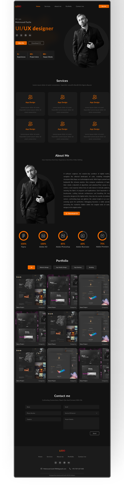

# 🎨 Personal Portfolio Website

A responsive, dark-themed personal portfolio for a **UI/UX Designer**, built with plain **HTML, CSS and a little JavaScript** — no frameworks, no build step.



> 📌 Add a full-page screenshot of your site at `images/preview.png`.

## 🔗 Live Demo

[View the live site](https://your-username.github.io/your-repo-name/)

> Replace with your GitHub Pages URL after deploying.

---

## ✨ Features

- 🌑 Dark theme with an orange accent color (`#fd6f00`)
- 📱 Fully responsive, with layouts for desktop, tablet and mobile (breakpoints from 1024px down to 320px)
- 🍔 Mobile hamburger menu that toggles open/closed with JavaScript
- 🧑‍💻 Hero section with intro, social icons, **Hire Me** / **Download CV** buttons and quick stats (5+ experience, 20+ projects, 80+ clients)
- 🛠️ Services section with six service cards
- 👤 About Me section with bio, photo and CV download button
- 📊 Skills section with circular progress indicators
- 🖼️ Projects gallery with category tabs (All, Website Design, App Mobile Design, App Desktop, Braiding)
- 📬 Contact form (name, email, phone, service, date, project details)
- 🔗 Footer with navigation, social links and contact info

## 📑 Sections

| Section | What it contains |
|---------|------------------|
| **Header** | Logo, navigation links, "Hire Me" button (hamburger menu on mobile) |
| **Hero** | Name, title "UI/UX designer", social icons (Instagram, LinkedIn, website, GitHub), CTA buttons, stats |
| **Services** | Six "App Design" cards with icon, title and description |
| **About Me** | "User Interface And User Experience And Also Video Editing", bio text, Download CV |
| **Skills** | Figma 100%, Adobe XD 100%, Adobe Photoshop 85%, Adobe Premiere 65%, ChatGPT 100% |
| **Projects** | Nine project preview images with category filter tabs |
| **Contact Me** | Inquiry form |
| **Footer** | Logo, links, social icons, email, phone |

## 🛠️ Built With

- **HTML5**: page structure
- **CSS3**: custom properties (CSS variables), Flexbox/Grid, media queries
- **JavaScript (vanilla)**: mobile menu toggle
- **[Font Awesome 7](https://fontawesome.com/)** (CDN): icons
- **Segoe UI** font stack

## 📂 Project Structure

```
Portfolio/
├── index.html        # Page markup
├── style.css         # All styles and responsive rules
├── script.js         # Mobile menu toggle
└── images/
    ├── man.png       # Profile photo (hero + about)
    └── project1.png  # Project preview image
```

## 🚀 Getting Started

### Run locally

```bash
git clone https://github.com/your-username/your-repo-name.git
cd your-repo-name
```

Then open `index.html` in your browser (or use the **Live Server** extension in VS Code). No installation needed. An internet connection is required for the Font Awesome icons.

### Deploy with GitHub Pages

1. Push the project to GitHub (keep `index.html` in the repository root).
2. Go to **Settings → Pages**.
3. Under **Source**, choose the `main` branch and `/ (root)`.
4. Save, and your site will be live in a few minutes.

## 🎛️ Customization

- **Colors:** edit the CSS variables at the top of `style.css` (`--orange`, `--body`, `--light`, `--gray`, …)
- **Content:** update text, services, bio and skill percentages in `index.html`
- **Photo and projects:** replace `images/man.png` and `images/project1.png`
- **Social links:** the icon links currently have empty `href=""`, so add your own URLs
- **CV button:** link the "Download CV" buttons to your CV file

## 🔮 Roadmap

- [ ] Make the project category tabs filter the gallery
- [ ] Connect the contact form to a service such as Formspree or EmailJS
- [ ] Hook up the nav links to scroll to each section (`href="#"` placeholders)
- [ ] Add real project images and descriptions
- [ ] Add smooth scrolling and animations

## 📞 Contact

**Mahmood Fazile**, UI/UX Designer

- 📧 moazamatunio786@gmail.com
- 📱 +92 3190235733

## 📄 License

This project is open source under the [MIT License](LICENSE).

---

⭐ If you like this project, give it a star!
